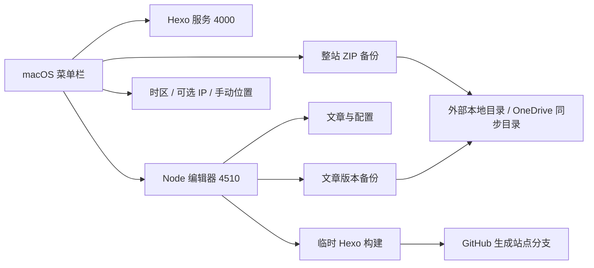

# Moonlit Desk 完整项目说明

维护日期：2026-11-25；当前版本 1.2.0（build 5）。本文说明的是当前仓库实现，不把未来规划写成已有功能。

阅读入口：[交接文档](HANDOFF.zh-CN.md) · [开发提示词](DEVELOPER_PROMPT.zh-CN.md) · [英文 README](../README.md)。

## 最新界面入口：统一设置与双语

应用默认英文，从下拉框选择简体中文后立即切换并自动保存 `language=zh`。原生菜单、设置窗口、编辑器按钮和常见提示共用翻译词典；文章文本、标题、标签名称不自动翻译。

- **左键单击菜单栏图标**：打开编辑器、新建文章、启动／停止 Hexo、打开博客、立即备份、打开备份／博客目录、查看日志。
- **右键单击／Control-click**：Settings…、About Moonlit Desk、Quit。
- **设置窗口**采用原生 NSWindow + 本地 WKWebView，具有通用、博客与目录、备份、月相与显示、网站信息、标签与分类、GitHub 发布、AI 写作、关于九个侧边栏分区。
- 所有长期配置均进入此窗口；编辑器只保留文章本身的属性面板。编辑器 Settings 按钮通过 `moonlitdesk://settings` 打开同一窗口，不再弹旧网站设置对话框。
- 首次未连接博客时打开设置的博客分区；选择目录、创建站点和备份目标的文件选择框仍由用户点击触发。
- 只运行 Node 但未安装注册 macOS 应用时，仍可编辑文章；统一原生设置入口不可用，必要时通过博客配置文件／configure CLI 配置。

## 1. 产品定位与边界

Moonlit Desk 是独立的 macOS 菜单栏工具，加一个本地浏览器文章编辑器。它连接用户选择的 Hexo 博客，启动预览、编辑内容、备份版本及推送生成的网站。

工具源码与博客源码是两个项目。工具不内置某个人的文章、头像、域名、主题、邮箱或 GitHub 凭据，也不要求使用某个主题。网站主题的语言路由、深色配色、页面字体和网站月亮动画由网站主题负责。

| 部分 | 保存在哪里 | 谁负责 |
| --- | --- | --- |
| 工具 Swift / JS / UI | 此 Git 仓库 | Moonlit Desk |
| 文章、主题、Hexo 配置 | 所选博客目录 | 用户的 Hexo 项目 |
| 当前博客、备份目标 | 用户 Application Support | 本机设置 |
| 菜单栏样式、位置模式、备份频率 | macOS UserDefaults | 本机偏好 |
| GitHub 身份与访问凭据 | GitHub CLI 的凭据机制 | gh |
| 文章版本与整站 ZIP | 外部备份目录 | 工具写入；OneDrive 客户端同步 |
| 生成网站 | 目标 GitHub 部署分支 | 发布器 |

公开源码仓库：[jiahecairen/Moonlit_Desk](https://github.com/jiahecairen/Moonlit_Desk)。应用显示名为 **Moonlit Desk**，本地文件夹采用 **Moonlit_Desk**。

## 2. 能力清单

### 2.1 菜单栏

- 选择或切换现有 Hexo 目录。
- 在所选父目录下创建新的 Hexo 网站，安装依赖并构建验证。
- 启动、停止由本应用启动的本地 Hexo 进程。
- 检查 4000 端口占用，打开本地博客、日志、博客目录。
- 打开本地文章编辑器。
- 手动或按天、按周创建整站 ZIP 备份；支持仅手动模式。
- 选择、打开备份目录；自动识别单个 OneDrive 文件夹。
- 登录时启动（macOS 13+ 的 ServiceManagement）。
- 默认仅显示月相；可添加工具名、网站名，或使用最多两个自定义字符／表情。
- 月相按当前时间选择网站同款八个 Unicode 月亮表情，按估算位置旋转朝向。

### 2.2 文章编辑器

- 列出 `_posts`、`_drafts` 下的 Markdown；显示草稿／隐藏文章状态。
- 按文章标题、第二语言标题、路径搜索；当前没有正文全文索引。
- 默认富文本，切换按钮可在富文本与完整 Markdown 之间往返。
- 常用工具：撤销、重做、段落／标题 1–4／引用、粗体、斜体、下划线、无序／有序列表、链接、图片。
- 高级工具：删除线、上标、下标、行内代码、代码块、插入表格、表格加行、移除表格、分隔线、缩进、取消链接、清除格式、折叠内容。
- 格式按钮显示当前选择的状态；仅富文本支持的工具在 MD 模式禁用。
- 插入文件、粘贴图片、拖入图片；支持 PNG / JPEG / GIF / WebP，每张不超过 10 MB。
- 编辑标题、第二语言标题、日期、标签、分类及关键词。
- 新文章任填英文标题、中文标题或文件名之一；有英文时自动生成短横线文件名，否则中文转拼音并以下划线连接。
- 自定义折叠区域标题；编辑时展开，序列化到网站时默认收起。
- 停止输入约 1 秒后自动保存并备份；Cmd+S / Ctrl+S 可立即冲刷，界面不要求点击保存。

### 2.3 网站及发布

- 修改网站名称、副标题、描述、网站关键词。
- 全站新增、重命名、移除标签／分类／关键词，更新引用文章。
- 保存 GitHub 目标仓库、部署分支、网站 URL；可创建公开或私有仓库。
- 发布时先保存当前文章、备份文章，再在临时快照中构建整个站点并推送生成文件。
- 空仓库／新部署分支可首次推送；内容无变化跳过提交。
- 可选将目标分支配置成 GitHub Pages 来源。

## 3. 环境与首次运行

推荐 macOS 13+、Node.js 22 LTS、npm、Git、GitHub CLI、Xcode Command Line Tools。`package.json` 当前声明 Node >=20，但新建 Hexo 固定使用 Hexo 8.1.2，应实际使用 Node >=20.19。工具本身不打包 Node 可执行程序。

```sh
git clone https://github.com/jiahecairen/Moonlit_Desk.git
cd Moonlit_Desk
npm ci
npm run build:mac
open 'Moonlit Desk.app'
```

首次没有项目设置时会显示博客目录选择框。这是用户操作所需的文件选择框，与定位授权弹窗不同。取消后仍可从菜单创建博客。

仅启动编辑器：

```sh
npm run configure -- /absolute/path/to/hexo-blog
npm start
# 或仅对本次启动指定：
npm start -- --project /absolute/path/to/hexo-blog
```

编辑器地址为 `http://127.0.0.1:4510/`。启动博客服务后预览地址为 `http://127.0.0.1:4000/`。本地 API 的 Host 校验只接受 127.0.0.1 加实际端口，不能直接替换为 localhost 或局域网 IP。

## 4. 实际使用流程

### 4.1 接入已有博客

1. 右键菜单栏打开设置，在 Blog & Folders 中选择包含 `_config.yml` 与 `package.json` 的博客目录。
2. 博客需自行安装其 `node_modules`，并具有可用的 Hexo 服务命令。
3. 选择“启动 Hexo”，再打开本地博客。
4. 选择“打开文章编辑器”。如果 4510 已有匹配项目的编辑器，会直接复用。
5. 切换博客会关闭本应用拥有的旧编辑器／Hexo 进程，并重建功能对象。

### 4.2 新建 Hexo

1. 设置 → Blog & Folders，点击 Create a Hexo Blog…。
2. 选择父目录，填写一个尚不存在的文件夹名称及网站名。
3. 后端在父目录的 `.moonlit-create-<UUID>` 中创建官方 CLI 自带模板。
4. 使用 `--no-clone --no-install` 生成文件，避免依赖 Git 克隆模板。
5. 固定模板的 Hexo 版本为 8.1.2，执行 npm install。
6. 运行构建，必须存在 `public/index.html`。
7. 再检查目标目录仍不存在，才将临时目录重命名为最终目录。
8. 应用自动连接新项目；用户再打开编辑器配置 GitHub。
9. 失败会移除创建阶段临时目录，日志保留在本机。

### 4.3 写文章

“新建文章”表单阶段不写磁盘；点击开始写作后，约 1 秒首次自动保存草稿。默认保存位置是草稿。手工文件名只允许英文、数字、`-`、`_`，最长 120 字符，优先于自动生成。标题最长 180 字符。

新文章不会自动生成 Chinese version，也没有自动翻译。第二语言标题字段写入 `title_zh`，它并不自动实现网站语言路由。

文章属性的多选列表沿用原生 select，多选时需使用 Cmd / Ctrl；新增标签／分类会同时选择新项。关键词用逗号分隔。分类列表是 Hexo 的 `categories`，不是文件夹移动功能；日期归档由文章日期及 Hexo 归档插件生成。

### 4.4 添加折叠内容

点击“Advanced → Folded Content”（中文为“高级 → 折叠内容”），输入自己的标题，再在展开的区域里写内容。生成结构如下：

```html
<details>
<summary>补充说明</summary>

这里是点击标题后才显示的内容。

</details>
```

保存时不写 `open`。网站主题仍可影响默认样式；编辑器不是网站主题的精确预览。已有文章的 Chinese version 不会被批量删除或重命名。

### 4.5 GitHub 发布

1. 用户在终端完成 `gh auth login`。
2. Settings → GitHub Publishing 填写目标 `owner/repository` 或 GitHub URL。
3. 指定部署分支，建议专用分支如 `gh-pages`。
4. 填写网站公开 URL。项目 Pages URL 应含 `/repository/` 路径。
5. 有效的目标配置会自动保存；如需要，可点击创建仓库。
6. 点击发布，确认范围：生成并推送整个已保存的网站，而不仅是当前文章。
7. 当前草稿会转入 `_posts`；失败后不会自动搬回草稿。
8. 可选 Pages 配置发生在 push 之后，API 失败会报告“已推送但 Pages 配置失败”。

推送的是生成 HTML、样式和资源，不是 Hexo 源码 Git 同步。不得把这一按钮解释成“备份源码到 GitHub”。远端已有同名生成文件会被更新；仅删除上次生成清单中本次不再生成的路径；其他无关文件通常保留。

## 5. 位置与月相：无需授权弹窗

### 5.1 当前默认行为

Settings → Moon & Appearance 可配置位置来源，默认 `moonLocationMode=timezone`。不调用 CoreLocation，不请求 GPS，不进行 IP 查询，不使用 Wi-Fi 扫描 API。应用的 Info.plist 已去掉定位权限说明键。

读取系统时区后，查本机 `/usr/share/zoneinfo/zone.tab` 的代表城市坐标；系统表不可读时使用应用自带 IANA 公有领域表。例：Europe/Dublin 映射为时区代表城市，而非用户真实当前位置。

时区可能覆盖很大区域，也可能被用户手动设置。该方法适合近似调整月面方向，不能用于导航、精准天气、日出月出计算或证明真实所在地。UTC 等无法匹配的时区不猜测纬度，仍显示当前月相，使用标准朝向。

### 5.2 三种模式

| 模式 | 授权弹窗 | 是否联网 | 位置精度与回退 |
| --- | --- | --- | --- |
| 系统时区估算，默认 | 无 | 无 | 时区代表城市；无法匹配则标准朝向 |
| IP 城市定位，主动选择 | 无 GPS 授权 | HTTPS 到 ipapi.co | 出口 IP 的估算城市；失败回退时区 |
| 手动经纬度 | 无 | 无 | 用户输入；范围校验后本机保存 |

IP 模式通过 `https://ipapi.co/json/` 查询当前出口 IP，不发送文章、网站配置、账号或 GPS 坐标。服务商自然能看到发起请求的出口 IP。VPN、代理、移动网络可使结果偏离实际所在地。应用不保存接口返回的原始 IP 字段。

IP 缓存有效期 6 小时；失败重试间隔至少 1 小时。单次请求超时 6 秒，资源超时 8 秒，响应需 HTTP 200、有效 JSON、有效数字坐标且不超过 64 KiB。切换模式会取消旧请求；代次标记避免旧请求覆盖新设置。未访问真实外部 IP 服务的自动化测试不代表服务在线或免费配额可用。

### 5.3 月相及图标

- `LunarPhase.swift` 实现 SunCalc 1.9.0 的近似太阳／月球坐标、照明比例与月相公式。
- 月相主要由时间决定；地理位置用于计算观察者的月面方向。
- 昼夜、天气、月球是否在地平线以上都不决定是否显示图标。
- 每 60 秒及打开菜单时刷新。
- 按连续相位最接近的八分之一选择 `🌑🌒🌓🌔🌕🌖🌗🌘`。
- 使用 Apple Color Emoji 绘制，与 macOS 上网站的 Unicode 表情来源一致。
- 图标必须 `isTemplate=false`；改为模板会在浅色菜单栏被系统染成黑色圆。
- 输出为 22×22 逻辑点，表情字号 18，按本地观察角旋转；不是逐像素连续绘制终止线。
- Finder／启动台的应用图标固定为 🌗 的高清透明 PNG 版本，先增强母图，再生成 ICNS，使用 CFBundleIconFile 指向 MoonlitDesk.icns，与菜单栏实时图标独立。
- 编辑器标签中的月亮动画仍是每 1.5 秒循环，不是菜单栏的实时天文月相。

### 5.4 旧设置迁移

已有 `moonLocationMode` 时保留选择。没有新键时：旧 `moonAutoLocation=false` 且有旧坐标，迁移成手动；旧自动定位开启或没有旧设置，迁移为 timezone。旧授权状态不会导致新版本调用定位 API。旧坐标键不主动清除，但默认时区模式不读取它们。

## 6. 架构与文件地图



### 6.1 Swift 文件

| 文件 | 职责与关键入口 |
| --- | --- |
| `mac-launcher/main.swift` | Launcher 主入口、菜单、项目切换、备份调度、生命周期、`--backup` CLI |
| `Services.swift` | BackupService、HexoServer、StudioSettings |
| `EditorFeature.swift` | 检查编辑器 session 的项目路径，启动并轮询就绪，打开浏览器 |
| `ProjectCreator.swift` | 选择父目录、输入新站点信息、启动创建脚本、完成后连接 |
| `StatusAppearance.swift` | 显示偏好、旧设置迁移、位置来源、IP 缓存、异步站点名称；提供 preferences/apply，不再自己弹设置框 |
| `SettingsWindow.swift` | 单例设置窗口、WKWebView、本地文件导航限制、消息桥、侧边栏分区打开 |
| `Localization.swift` | Swift 界面语言，读取共享 JSON 词典 |
| `MoonLocation.swift` | 坐标校验、IANA ISO6709 坐标解析、时区匹配、IP JSON 校验 |
| `LunarPhase.swift` | 不依赖 UI 的月相与方向计算 |
| `MoonIcon.swift` | 网站同款彩色 emoji，禁止模板染色 |
| `Resources/zone.tab` | 离线时区代表城市坐标备用表 |
| `build.sh` | 打包 Resources、编译 Swift、生成 plist、临时签名 |
| `make-icon.swift` | 将高清透明月亮母图缩制成 16–1024 像素图标组，再由 iconutil 打包 ICNS |
| `test.sh`、`tests/` | 月相与位置解析的独立可执行测试 |

`LauncherFeature` 提供 `menuItems()`、`shutdown()` 与 `isBusy` 扩展点。它是编译期协议，不是已经实现的第三方插件加载器。新功能需编译进应用并在 configureFeatures 中注册。

### 6.2 Node 文件

| 文件 | 职责 |
| --- | --- |
| `editor/server.js` | HTTP 路由、Host / Origin / token、文章路径与 revision、上传及发布状态 |
| `project.js` | 设置文件、项目选择优先级、source_dir、站点标识 |
| `configure.js` | CLI 设置当前博客 |
| `project-setup.js` | 临时创建新站点、安装、验证、最终 rename |
| `build-site.js` | 从目标博客解析 Hexo 包，generate force+bail |
| `article-name.js` | 标题校验、英文 slug、无声调拼音 slug |
| `article-backups.js` | 备份目录规则、资源收集、内容哈希去重 |
| `metadata.js` | YAML 文章属性、标签／分类／关键词聚合与全局修改 |
| `configuration.js` | 保留注释的 Hexo 配置写入、GitHub repo / Pages 配置 |
| `publisher.js` | 临时快照、构建、Git checkout、生成清单、push |
| `command.js` | 无 shell spawn、PATH 补充、超时、输出尾部、禁交互凭据 |
| `ai/config.js` | AI 配置文件、仅允许本机地址、AI 数据目录与原子写 |
| `ai/provider.js` | OpenAI 兼容客户端：models、chat（含流式）、embeddings，过滤 `<think>` |
| `ai/corpus.js` | 文章清洗、段落切分、增量索引、关键词（字二元组 BM25）或向量检索 |
| `ai/style.js` | 风格统计、跨时间抽样、模型生成风格说明、风格档案读写 |
| `ai/polish.js` | 分批、提示词、输出清理、事实保真检查 |
| `ai/routes.js` | `/api/ai/*` 路由与流式润笔 |

### 6.3 浏览器文件

| 文件 | 职责 |
| --- | --- |
| `index.html` | 布局、常用／高级工具、文章属性、对话框 |
| `style.css` | 编辑器配色、纸张区、工具栏和响应式 |
| `app.js` | 当前文档状态、载入／保存／发布、模式切换、图片与工具栏 |
| `settings-ui.js` | 文章属性队列与目录选项；Settings 按钮打开原生统一设置 |
| `preferences.html/.css/.js` | 九分区设置页面，使用受限原生消息桥访问偏好、网站与 AI 写作配置 |
| `polish-ui.js` | 润笔对话框：确定润笔范围、流式显示、事实检查提示、接受后替换 |
| `i18n.js`、`ui-strings.json/.js` | UI 翻译与共享词典；不遍历文章正文作翻译 |
| `rich-editor.js` | RichDocument、HTML 清理、Markdown 序列化、光标、表格及折叠 |
| `editor-moon.js` | 编辑器标题和标签的表情循环 |

脚本使用传统 defer 全局作用域，`settings-ui.js` 共享 app.js 的状态；启动入口绑定 DOMContentLoaded，确保依赖脚本都执行。它们不是 ES Modules，不可任意交换加载顺序。

### 6.4 统一设置的原生桥

settings HTML/JS 加载自 app 的 Resources/editor，不能作为公网设置服务使用。`SettingsWindow` 仅接收主 frame 且 URL 精确匹配 preferences.html 的消息；导航限制在资源目录本地文件。

调用格式为 `{id, action, input}`，经 `window.webkit.messageHandlers.settings.postMessage` 送到 Swift，再以 `window.settingsResponse({id,data})` 或 `{id,error}` 返回。页面为请求设置 200 秒超时；所有用户输入经 JSON 序列化回传，不拼接可执行脚本内容。

支持的 action：state、save-language、save-general、save-backups、save-appearance、choose-project、create-project、choose-backup、open-backup、open-project、login-settings、open-editor、open-repository，以及 api。

api 只允许 api/settings、api/site、api/taxonomy、api/deployment、api/repository。`EditorFeature` 确认匹配当前项目的服务已启动，读取 token，再以正确 Origin 调本地接口。不允许通过桥任意访问路径／执行 shell。没有项目时，网站相关设置显示先连接博客的提示。

通用设置的登录项只在 checkbox 与实际状态不一致时才调用 ServiceManagement；单独切换语言不应产生注册／注销操作。语言保存后更新窗口标题与菜单；编辑器每 2.5 秒，以及窗口 focus / visibilitychange 时读取 /api/preferences。

`languages.json` 是语言注册表，条目为 code / label / htmlLang / catalog；当前 en 指向 ui-strings.json，zh 使用中文原文。`generate-i18n.js` 生成 ui-strings.js 的注册表与词典包，build.sh 自动生成，也可 npm run i18n:generate。新增语言只需添加条目及中文键到目标语言的 JSON 词典；缺失键回退英文，未知 code 回退 en。Swift、Node 和浏览器读取同一注册表，避免固定两个语言按钮。编辑器初始静态 UI 文本记录原文，语言切换仅更新 UI 节点、属性和特定状态节点，排除文章正文、文章列表用户标题等内容。

## 7. 本地数据与配置字典

### 7.1 工具设置 JSON

默认：`~/Library/Application Support/Moonlit Desk/settings.json`。

```json
{
  "projectPath": "/absolute/path/to/blog",
  "backupFolder": "/absolute/path/outside-blog/Backups"
}
```

| 键 | 含义 |
| --- | --- |
| projectPath | 当前 Hexo 根目录，必须存在两个配置文件 |
| backupFolder | 整站备份目标；文章备份在其下按站点隔离 |
| articleBackupPath | 兼容旧版本，且项目匹配时使用的直接文章目标；切换项目／目标时清除 |
| language | 注册表中的语言 code，en 默认；下拉框选择后独立自动保存，编辑器通过只读 API 同步 |
| bilingual | 遗留兼容键，session 返回；不再决定新文章插入翻译区 |

Swift 保存 JSON 为原子写，权限 0600；CLI configure 使用临时文件 rename。不要将该 JSON 提交到工具仓库。

### 7.2 Node 环境变量

| 变量 | 含义 |
| --- | --- |
| MOONLIT_PROJECT | 优先于 --project 和 settings 的博客路径 |
| MOONLIT_SETTINGS | 覆盖 Node 侧设置文件路径；不改变 Swift 的固定设置位置 |
| MOONLIT_ARTICLE_BACKUPS | 文章版本的直接根目录，优先级最高 |
| EDITOR_PORT | Node 编辑器端口，默认 4510；原生 UI 仍固定打开 4510 |
| MOONLIT_DEPLOY_TEST_REPO | 测试专用本地 Git 远端覆盖；生产环境不应设置 |

项目选择顺序：环境变量 → `--project` → JSON projectPath。编辑器进程启动时固定 root 和 source，切换网站需重启该进程。

### 7.3 UserDefaults

域：`org.moonlitdesk.app`。没有写入时使用默认值；不要为测试执行整个域的 delete。

| 键 | 值及默认 |
| --- | --- |
| backupHours | 24 默认；168 每周；0 仅手动 |
| lastBackup | 上次成功运行备份检查的 Date；相同内容复用 ZIP 也会更新时间 |
| menuNameMode | none 默认、app、site |
| menuIconMode | moon 默认、custom |
| menuCustomIcon | ✦ 默认，最多两个 Swift Character |
| moonLocationMode | timezone 默认、ip、manual |
| moonManualLatitude / moonManualLongitude | 仅手动位置 |
| moonIPLatitude / moonIPLongitude / moonIPLabel / moonIPDate | IP 结果与缓存时间 |
| moonAutoLocation / moonLatitude / moonLongitude | 仅迁移旧版本，不再触发系统定位 |

### 7.4 博客 `_config.yml`

```yaml
title: My Blog
subtitle: A personal site
description: Notes and stories
keywords: writing, learning
url: https://example.github.io/my-blog/
root: /my-blog/
source_dir: source
deploy:
  type: git
  repo: https://github.com/example/my-blog.git
  branch: gh-pages
moonlit:
  github_pages: true
  taxonomy:
    tags: [Writing]
    categories: [Notes]
    keywords: [learning]
```

配置写入使用 yaml AST，保留注释，写前比对原文本防止覆盖并发修改。旧版本配置保存在博客 `.moonlit/config-versions/<SHA256>.yml`，这一类备份不是单独写入文章 OneDrive 目录。

保存部署 URL 时同时设置 root；用户不填 URL 时保留原值。`deploy.repository` 也被发布器接受。Settings 保存时使用 `deploy.repo`。

## 8. HTTP API 合约

GET 接口也只接受正确 Host。所有非 GET 请求需要 `Origin: http://127.0.0.1:<port>` 和 `X-Editor-Token`。token 从 session 获得，进程重启后失效。JSON POST 使用 Content-Type application/json。

| 方法与路径 | 主要输入 | 返回或作用 |
| --- | --- | --- |
| GET /api/session | 无 | token、项目、备份路径、网站名、部署目标、兼容 bilingual |
| GET /api/articles | 无 | 已按日期字符串倒序的文章摘要数组 |
| GET /api/article | query path | text、revision |
| POST /api/article | path、text、revision | 校验、备份、写入；返回 revision、backup、unchanged |
| POST /api/article-name | title、chinese、slug | title、titleZh、slug；不创建文件 |
| POST /api/preview | text | title、html、frontMatter、warning、metadata |
| POST /api/image | 原始图片字节 | 201、url；不使用 multipart |
| GET /api/preferences | 无 | 当前界面 language；只读 |
| GET /api/settings | 无 | site、deployment、taxonomy、account |
| GET /api/taxonomy | 无 | tags / categories / keywords 数组 |
| POST /api/metadata | text、patch | frontMatter、metadata；只转换文本，不落盘 |
| POST /api/site | title、subtitle、description、keywords | 写配置；返回 title |
| POST /api/taxonomy | kind、action、name、replacement | 全局变更；返回 taxonomy、updated |
| POST /api/deployment | repository、branch、siteUrl、githubPages | 写 deploy；返回 repository、branch |
| POST /api/repository | repository、visibility | 调 gh 创建远程仓库 |
| POST /api/publish | path、revision | 202，启动异步构建推送 |
| GET /api/publish | 无 | idle / running / success / failed 及消息、结果 |
| GET /api/ai/status | 无 | AI 配置、索引摘要、风格档案状态、本地模型连接与模型列表 |
| POST /api/ai/config | baseUrl、model、embeddingModel、includeDrafts、includeHidden | 校验并保存 AI 配置 |
| POST /api/ai/index | 无 | 增量更新段落索引与向量 |
| GET/POST /api/ai/profile | text（POST） | 读取／保存风格档案，上限 20000 字符 |
| POST /api/ai/style | 无 | 用本地模型生成风格档案，旧档案存为 style.previous.md |
| POST /api/ai/polish | text、mode（light/full/expand）、instruction、path | 200 NDJSON 流：start、batch、delta、done（output、issues、references）或 error |
| GET /images/... | 路径 | 图片字节，校验图片签名 |
| GET /vendor/... | 固定白名单 | DOMPurify、Turndown、GFM 浏览器包 |

文章、预览和配置类请求体上限通常为 2 MiB；命名接口 8192 字节；图片 10 MiB。超限返回 413。错误 JSON 为 `{ "error": "说明" }`。

常见错误：400 输入不合法，403 Origin/token/Host 错误，404 路径不存在，409 外部修改或发布冲突，503 备份失败。未分类异常以 500 和通用权限提示返回，排查时需看日志／进程输出。

## 8.1 自动生效与保存调度

- 设置窗口不再有保存按钮。开关／下拉在 change 时保存，文字在 input 后约 700 ms 或 change/blur 时保存。
- `AutoSaveQueue` 合并连打输入，串行处理同一表单的写入，保留写入期间的新修改；错误显式显示，不虚报成功。
- 通用保存只处理登录项；语言走 save-language，选择立即预览、独立持久化，失败回退之前的选择。
- 表单无效时等待完整输入，例如空标题、未填坐标的手动位置、未完成的仓库路径。最后有效配置保持不变。
- 切换博客会取消旧网站／部署表单的待写入项；桥请求携带 projectPath，原生端核对当前项目。EditorFeature 的忙碌标记覆盖原生桥请求，防止写入期间切换目标。
- 关闭设置窗口／经菜单退出时请求冲刷队列。发布、创建仓库、标签的新增／重命名／删除仍是明确操作按钮，并无额外保存步骤。
- 文章正文、Markdown、格式、图片引用、已提交的文章属性修改在停止输入约 1 秒后自动保存并版本备份；切换文章先冲刷，保存中产生的新输入会接着保存。
- 文章 API 的 YAML/title 验证、revision 冲突和备份失败保护保持原样；失败状态不自动循环重试，继续编辑或 Cmd/Ctrl+S 可以再次尝试。

## 8.2 本地 AI 润笔（第一阶段：风格档案 + 检索，不训练）

- **入口**：编辑器工具栏“✒︎ 润笔”。有选区只润笔选区（富文本用 Turndown 转成 Markdown，MD 模式按 textarea 选区），否则润笔整篇正文，顶部 YAML 不发送也不改动。
- **流程**：增量更新索引 → 按段落分批（每批约 1500 字，代码围栏不拆开）→ 每批检索相似旧文段落 → 拼装提示词（硬性规则 + 风格档案 + 示范段落 + 草稿）→ 流式返回。
- **接受前不改文章**：结果在对话框中左右对照，可编辑；点“替换原文”后才写回编辑器，随后走原有自动保存、revision 校验与版本备份。富文本选区替换需先关闭模态框再执行 insertHTML（模态框打开时编辑区是 inert）。整篇替换后重新渲染富文本，撤销栈不覆盖这一步，可从版本备份找回。
- **索引**：只收 `_posts`，草稿和 `hidden: true` 需在设置中勾选。去掉代码块、HTML、图片和链接地址；按段落合并为约 360 字的块，长段按句子切分。文章内容哈希不变就跳过；向量按段落哈希缓存，换嵌入模型会重算。
- **检索**：默认字二元组 BM25，不依赖分词库；配置嵌入模型且所有段落都有向量时用余弦相似度，失败回退关键词检索并提示。每篇最多取 2 段、总计约 2400 字，排除当前正在编辑的文章。
- **风格档案** `style.md`：模型按时间均匀抽样最多 12 篇（每篇约 900 字，总计 10000 字）写风格说明，代码再追加统计特征（句长、段长、标点、连接词、表情、小标题、拉丁字母占比）。档案可直接编辑，修改后自动保存；只有点“生成风格档案”时才把旧版本保存到 `style.previous.md`。
- **事实检查**：比较润笔前后的数字、链接、图片、行内代码，以及英文词或专有名词（只报告缺失，大小写不敏感，不比较网址片段）。只提示，不阻止替换。
- **模型服务**：任何 OpenAI 兼容接口，默认 `http://127.0.0.1:8080/v1`（mlx_lm.server）；只接受 127.0.0.1、localhost、::1，不跟随重定向。模型名留空时请求不带 model 字段，使用服务默认模型。推理模型输出的 `<think>…</think>` 会被过滤，即使标签被拆在多个流块中。
- **数据位置**：`~/Library/Application Support/Moonlit Desk/AI/`（可用 `MOONLIT_AI_HOME` 覆盖）。`config.json` 全局，`<siteKey>/index.json` 与 `<siteKey>/style.md` 按站点隔离；都不在博客目录，不会被发布或进入整站 ZIP。config 由 Node 单独写，避免与 Swift 写 settings.json 互相覆盖。
- **原生桥**：白名单增加 `api/ai/status`、`api/ai/profile`（可 GET）以及 `api/ai/config`、`api/ai/index`、`api/ai/style`；AI 请求超时 900 秒（其他仍为 180 秒），设置页对索引和生成风格档案也放宽到 900 秒。
- **限制**：不下载、不打包模型；润笔质量取决于所选模型。尚未做 LoRA 训练（第二阶段）、润笔历史记录、远程 API 或按段落逐条接受。停止后可以接受已生成的部分结果，需要自己检查。

## 9. 保存与转换机制

### 9.1 revision 与落盘

读取文章时返回原文本 SHA-256。保存时必须提交同一 revision；文件被外部编辑时返回 409，不直接覆盖。新文件 revision 为 null。服务端验证 YAML 和 title，先备份旧／新版本，再临时写入并 rename。

缺资源、备份不可写、已有版本校验失败时，返回 503，不修改文章。该顺序优先保证数据可恢复。单个 rename 是文件级原子操作，不代表整个跨文件批处理是数据库事务。

### 9.2 富文本保真边界

文章载入时不立即改写原始 Markdown，只有编辑后才转成新文本。marked 将正文渲染为 HTML，DOMPurify 清理可编辑 DOM，Turndown/GFM 转回 Markdown。YAML 头与正文分开维护。

iframe、视频、音频、脚本、样式等原始块替换为不可编辑占位卡，使用 rawBlocks 保留，切回 MD 可编辑。粘贴 HTML 会去掉脚本、iframe、form、style 等危险／复杂结构。不能理解为“任意 Word/HTML 无损往返”。

下划线、上下标等无通用 Markdown 标记的内容保留语义 HTML；表格单元格内换行归一成 `<br>`，管道符转义，避免打断表格行。保留 source 的未知 front matter 字段，但实际编辑属性时 YAML 的引号、空行等格式可能变化。

`metadataQueue` 串行提交文章属性转换；save 等待队列。正文在转换期间继续输入时，只替换确认未被另一个操作改变的 YAML 头，尽量不覆盖正文。

## 10. 备份细节与恢复

### 10.1 文章备份目标优先级

1. MOONLIT_ARTICLE_BACKUPS。
2. 当前项目匹配的旧 articleBackupPath。
3. backupFolder 下的 `<siteKey>/Articles`。
4. 检测到唯一 OneDrive 时，在其 Moonlit Desk Backups 下按站点隔离。
5. 否则 Application Support 的 Backups 下按站点隔离。

siteKey 是目录名的安全化文本，加博客 realpath SHA-256 的前 8 位。同名不同路径博客分开，移动博客路径会改变标识；历史备份不自动搬迁。

```text
<文章备份根>/_posts/example/versions/<内容哈希>/
  article.md
  manifest.json
  images/...引用资源
```

哈希由 Markdown 字节哈希及排序后的资源路径／字节哈希共同组成。同文同图重复保存／发布／恢复旧内容时复用已有版本；同文但图片改变会生成新版本。

收集 Markdown 图片及 HTML src 中的本地资源；忽略远程协议、data URL、锚点。根路径按 source_dir 解释；相对路径尝试文章目录及同名资源目录。资源 realpath 必须在 source 中。当前不是完整 HTML/CSS 依赖分析器，不采集 srcset 或 CSS background 的所有资源。

先写 `.pending-UUID` 再 rename。复用版本时校验 manifest、文章、资源，损坏版本阻止覆盖性保存。自动版本清理和恢复按钮尚未实现。

恢复方式：先复制当前文章与资源，再从指定版本取 article.md 覆盖原文章，按 manifest 资源路径恢复到 source_dir，重新打开文章获取新 revision，预览验证后再决定是否发布。不同版本的资源可能同名，应避免恢复过程覆盖其他文章依赖。

### 10.2 整站 ZIP

BackupService 使用 CryptoKit 对排序相对路径和内容求哈希，排除：node_modules、public、.git、.deploy_git、.editor、db.json、.DS_Store。符号链接按链接目标文本参与指纹；ZIP 以 `-y` 保存链接。

相同哈希已有 `Moonlit Desk-...-<hash>.zip` 时直接复用。新 ZIP 先在临时目录生成，unzip -t 校验，再重新计算指纹确认期间无变化，复制为目标 `.partial` 后改名。复用旧 ZIP 时不会重新 unzip 全面检测旧文件。

默认每天；每分钟检查是否到期，不精确到某一墙钟时间。仅应用运行时执行，没有独立 launchd 备份服务。失败等待 15 分钟再尝试。禁止把目标设在博客根或其内部，防止备份递归。

OneDrive 由其客户端负责远程上传，工具只确认本地写入成功；无 OneDrive 上传完成确认、远端一致性或云端恢复 API。整站 ZIP 不包含 node_modules 与 Git 历史，恢复后需 npm ci/install，源码仓库历史应另行备份。

## 11. 构建与分发

`npm run build:mac` 调用 build.sh：

1. 创建临时 .app 目录。
2. 打包 editor 与当前全部 node_modules；复制第三方声明与 zone.tab。
3. swiftc -swift-version 5 -O 编译本机架构。
4. 写 org.moonlitdesk.app、LSUIElement 等 plist；当前 App 与 npm 版本均为 1.2.0，App build 为 5。
5. ad-hoc codesign，ditto 到目标目录。

可传目标目录：`./mac-launcher/build.sh /absolute/output`。当前不是 Universal Binary、DMG 安装器或已公证发行版。Node/npm/git/gh 仍依赖系统环境；Finder 启动应用不会自动获得交互式 shell 的 nvm 环境。Node 查找主要覆盖 Homebrew 路径与已有 PATH。

应用启动后的 bundle Resources 是运行代码来源。修改源码后只刷新浏览器，仅适用于从源码运行的 Node 服务；若运行打包版，必须重建并重启应用及其编辑器进程，防止看到旧 UI。

## 12. 日志与诊断

| 路径 | 内容 |
| --- | --- |
| ~/Library/Logs/Moonlit-Hexo.log | 原生启动 Hexo 的输出 |
| ~/Library/Logs/Moonlit Desk-Editor.log | 原生启动编辑器的输出 |
| ~/Library/Logs/Moonlit-Setup.log | 新建站点安装与构建输出 |

日志通常追加写入，尚无轮转。命令输出错误保留最后约 16000 字符，普通命令超时 180 秒，新站 npm install 最长 600 秒。

| 现象 | 排查顺序 |
| --- | --- |
| 启动按钮不可用 | 4000 是否被其他程序占用；应用是否拥有该进程 |
| 不能停止已有服务 | 应用仅停止自身启动的进程，不会接管外部进程 |
| 找不到 Node | Homebrew 路径、已安装 Node、Finder PATH |
| 编辑器无法启动 | 4510 占用、服务项目路径不匹配、日志、应用版本 |
| 403 会话失效 | 地址是否为 127.0.0.1，重启后刷新 token |
| 409 保存冲突 | 先复制未保存正文，再重开磁盘文章比对 |
| 503 备份失败 | 目标目录权限、丢失图片、损坏 manifest、备份目录不能在博客内 |
| 发布失败 | gh auth status、仓库权限、分支设置、Hexo 构建错误、命令超时 |
| Push 成功但没上线 | Pages 状态、构建延时、域名 DNS、root 与 URL 配置 |
| 月亮是黑色圆 | 确认新版应用、MoonIcon.isTemplate=false、使用 Apple Color Emoji |
| 时区估算不准 | 时区是否真实；切换手动或主动 IP 模式 |
| 无权限弹窗但有文件框 | 初次项目目录选择框不属于定位；新版本不使用 CoreLocation |

## 13. 测试与验证范围

```sh
npm test
npm run test:mac
npm run build:mac
git diff --check
```

- `editor/workflow.test.js`：临时博客、HTTP 保存、命名、重复备份、图片备份、revision 冲突、备份失败不覆盖、临时 bare Git 远端发布、保留无关文件、无变化跳过、空远端首次推送、错误远端失败。
- `editor/autosave.test.js`：输入合并、写入中新编辑排队、错误和有效输入恢复、取消旧项目待写入项。
- `editor/localization.test.js`：默认英文、切换中文、未知语言回退、Swift/浏览器词典一致；HTTP workflow 同时检查保存偏好后只读接口更新。
- `editor/ai.test.js`：仅本机地址、语料清洗与隐藏／草稿过滤、增量索引与向量缓存、长段切分、风格统计、`<think>` 跨块过滤、分批与提示词、事实检查，以及用模拟 OpenAI 服务跑通配置、索引、风格档案、流式润笔、模型不可用时的错误。
- `editor/metadata.test.js`：front matter/body 保留、标签／分类／关键词批处理、版本备份、配置注释、部署 root。
- `LunarPhaseTests.swift`：SunCalc 固定参考数据、新月／满月、北半球／南半球朝向、位置缺失回退。
- `MoonLocationTests.swift`：IANA 分秒坐标、坐标范围、未知时区、IP 响应校验、默认实现没有系统定位权限调用。
- 本次构建测试不查询真实出口 IP，不创建测试 GitHub 仓库，不发布用户网站。

原生菜单点击、系统登录项授权、OneDrive 远程同步、外部 IP 服务可用性、真实 GitHub Pages 激活都需要独立人工或隔离环境验证。不能把本地 bare Git 测试说成真实上线验证。

## 14. 已知限制与开发优先级

这些是交接时应保留的信息，不表示本次全部修复：

1. 编辑器是 contenteditable + 浏览器命令，复杂嵌套、任意 HTML、Word 样式和完整主题不能保证保真；没有成熟编辑器文档模型或跨文档撤销栈设计。
2. 已有基础自动保存，但尚无崩溃恢复；防抖期间的尾部输入、非法 YAML 或写入错误仍可能让内存修改未落盘，离开页面时保留提醒。
3. 没有文章删除／文件移动／重命名 UI，没有内置版本恢复、预览版本 diff 或备份保留策略。
4. 修改来源目录、配置或主题后，现有 Node 进程的部分值需要重启；并非所有设置都热加载。
5. 多进程同时保存／发布没有跨进程锁。taxonomy 的回滚是尽力而为，不能覆盖所有断电／并发情况。
6. 发布源快照复制不是文件系统事务；复制期间外部写入可能让快照混合。草稿转正式早于远端成功，失败不自动逆转。
7. 发布目前只显式复制 themes、scaffolds、scripts、package 配置、主 _config 与 source；根目录其他 `_config.<theme>.yml`、自定义插件所需文件等应专项验证。
8. 图片上传 URL 为 `/images/editor/...`，项目式 Pages 的子路径、站点 asset_folder 及主题 url_for 行为需专项测试；设置 root 不等于修复所有绝对路径资源。
9. 图片已上传但未保存／删除引用后可能留孤立文件，没有资源清理。
10. 浏览器预览图片只直接服务 images 前缀；文章相对附件及非图片格式支持有限。
11. 当前 API 没有多用户登录、TLS 或公网部署设计。GET API 主要依赖本机访问边界；别把服务暴露给不可信网络。
12. 多个软件依赖较旧，升级 Hexo / marked / js-yaml / Turndown 应做实际兼容测试，不宜仅修改版本号。
13. 原生设置尚未完全模块化；自动备份状态按用户域记录，非每项目独立调度；应用不开就不备份。
14. 整站备份复用文件基于文件名中的哈希，未每次重新验证整个旧 ZIP；需要独立的备份巡检设计。
15. 未完成签名公证、跨架构、自动更新、国际化、安装引导、CI、正式 Release 管理。
16. 默认时区估算只精确到代表城市；IP 有外部依赖；图标是离散八月相，近似天文公式不适合科学测量。

## 15. 扩展建议与修改入口

- 新菜单功能：实现 LauncherFeature，管理 Process／Task 生命周期，注册并在忙碌时保护退出与切换。
- 新文章字段：metadata.js 的 view/edit、API 校验、settings-ui.js、HTML 表单及相应 round-trip 测试一起修改。
- 新富文本功能：先确定 Markdown/HTML 序列化和重载规则，再加 UI；只有视觉变化而保存丢失格式不算完成。
- 新云备份：在目标解析和写入层封装适配器；保持哈希去重、旧版兼容和备份失败不覆盖文章。
- 多站点：建立明确的站点集合、端口和进程归属模型，而不是重复启动全局固定端口。
- 发布源码：设计独立的源码 Git 功能，不能把现有生成分支强行混用。
- 成熟编辑器迁移：先为 HTML 嵌入、details、YAML 和表格建立样本集，再评估模型与转换兼容；保持现有文章可逆。

应用图标母图为 `mac-launcher/Resources/AppIconMoon-HD.png`（1254×1254，带 Alpha），由内置 imagegen 基于用户指定表情增强。构建时只从母图缩制，不再把小截图或系统字体直接放大作为应用大图标；处理提示词记录见同目录 AppIconMoon-HD.prompt.md。菜单栏继续使用系统彩色表情，与此静态图标独立。

## 16. 外部依据与许可证

- 工具源码许可证：[MIT](../LICENSE)。
- 月相公式：[SunCalc 1.9.0 源码](https://github.com/mourner/suncalc/tree/v1.9.0)，BSD 两条款声明在 [THIRD_PARTY_NOTICES.md](../THIRD_PARTY_NOTICES.md)。
- 时区表：[IANA zone.tab](https://data.iana.org/time-zones/tzdb/zone.tab)，文件头注明公有领域；更新时保留文件头，记录更新来源。
- 可选 IP 查询：[ipapi 官方接口说明](https://ipapi.co/api/)。本项目没有承诺外部服务的 SLA、长期免费或定位精度。
- emoji 使用系统字体渲染，未把 Apple 字体文件复制到仓库或应用。
